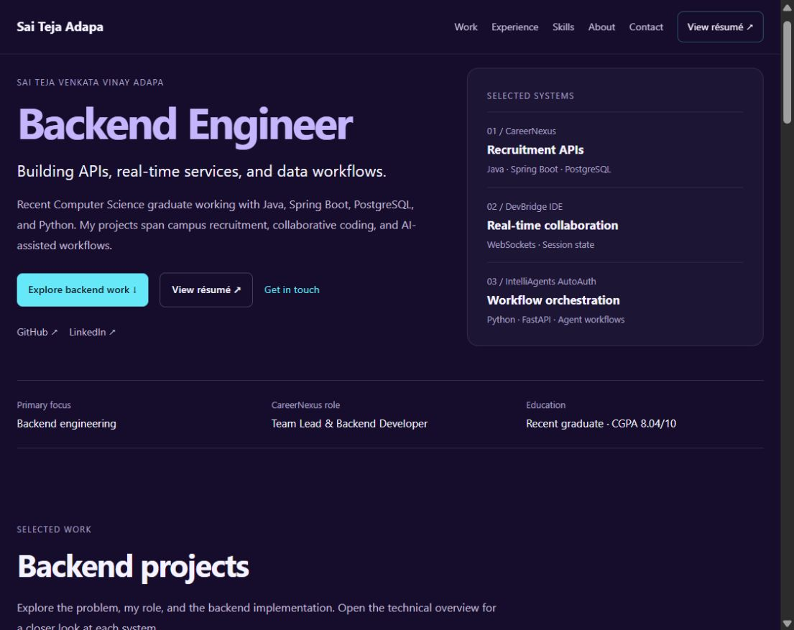

# Phase 1 portfolio information hierarchy

The portfolio uses one shared interface for every visitor. A concise project
summary leads into optional technical detail in the same page. There is no
audience selector, separate recruiter page, or separate developer page.

## Page structure

1. Header with Work, Experience, Skills, About, Contact, and a resume link.
2. Immediate hero with backend identity, a supporting statement, project and resume actions, and a compact evidence strip.
3. CareerNexus, DevBridge IDE, and IntelliAgents AutoAuth as the featured projects.
4. Professional experience visible in the main page flow.
5. Technical capabilities linked to relevant project evidence.
6. Compact background and education, with optional credentials.
7. Contact and footer.

Desktop uses a hero project index, paired project summary and backend focus,
two-column experience/background blocks, and three capability cards. Mobile
stacks the same content, prioritizes the hero actions and evidence, and uses a
navigation disclosure. The duplicate hero project index is omitted on mobile;
the actual project entries and their details remain available to every visitor.

## Discovery and navigation

The timed welcome screen, rotating role text, and looping hero video no longer
block or displace the introduction. Projects, experience, and skills no longer
require portfolio tab selection. Certificates and smaller projects use native
details elements so secondary content can be expanded with a mouse or keyboard.

Project fragments are stable links under the existing deployment path:

- `#career-nexus`
- `#devbridge-ide`
- `#intelliagents-autoauth`

Each entry contains a source link, a project permalink, an optional configured
demo link, and an expandable technical overview. The overview includes a return
link to selected work. Native anchors preserve browser history. Header offsets
keep linked content visible below the sticky navigation.

Full evidence-backed case studies and their final page presentation belong to
Phase 2. These fragments establish the navigation foundation without introducing
routes that require server fallback configuration on GitHub Pages.

## Content constraints

Phase 0 remains the evidence authority. No production scale or percentage claims
were added. IntelliAgents is labeled a team project; its personal ownership
boundaries remain pending. TaskLabs is described with its reported start date
without asserting that employment is currently ongoing. Resume freshness and
demo operation remain pending verification.

## Implementation

- `src/content/portfolio.js` holds navigation, the configured resume URL, and featured project summaries.
- `src/Experience.jsx` presents experience independently of project controls.
- `src/MainContent.jsx` defines the shared page order and main landmark.
- Native anchors and details provide navigation and progressive disclosure.
- Mobile menu supports Escape, returns focus to its trigger, and closes after link selection or a switch to desktop width.
- Global anchor offsets, visible focus, and reduced-motion scroll behavior support the new navigation.

The current layout is the Phase 1 foundation. The advanced 3D scene and motion
system remain planned for later phases.

## Validation

- Changed application components pass ESLint.
- Desktop and 390-pixel mobile inspections showed no horizontal overflow.
- The page has one primary heading and all internal anchor targets exist.
- Project navigation and technical overview expansion were verified in the local browser.
- Mobile menu Escape behavior, trigger focus restoration, and experience navigation were verified.
- A project fragment resolves below the sticky header.
- Production build validation remains unavailable under the previously declined escalation; local browser checks do not replace a production build.

