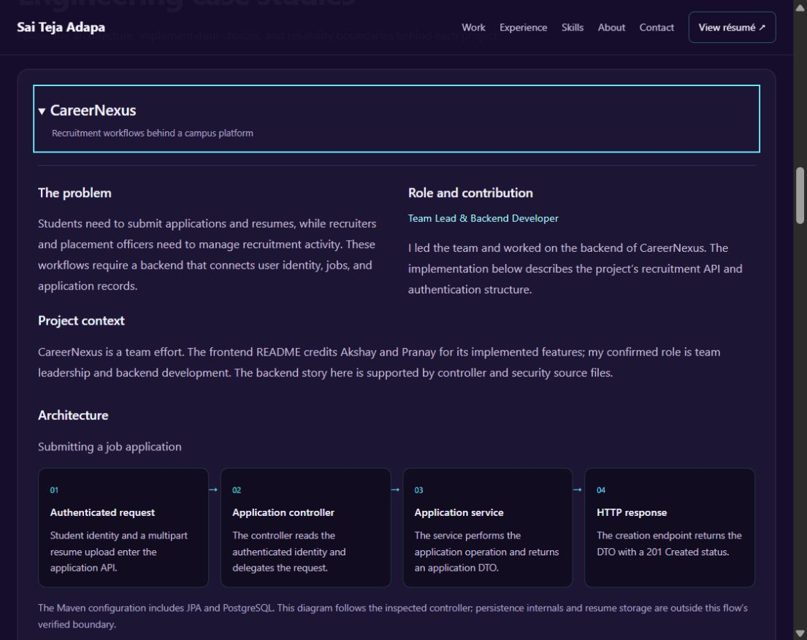

# Phase 2 backend project case studies

CareerNexus, DevBridge IDE, and IntelliAgents AutoAuth now have detailed case
studies within the shared portfolio. Each project preview links to an expandable
study covering the problem, role, architecture, engineering choices, reliability,
limitations, and source evidence. The previous short technical overview has been
replaced by this fuller reading path.

## Implemented experience

- Three stable case-study fragments open their content automatically.
- Links work on initial load, refresh, and repeated navigation to the same fragment.
- Native summary controls support keyboard expansion and collapse.
- Link navigation moves focus to the study summary and positions it below the header.
- Architecture flows use readable HTML steps, arranged horizontally on desktop and vertically on mobile.
- Each study includes two source-supported implementation choices with tradeoff analysis, plus a contract or workflow example.
- Evidence links point to the Phase 0 source revisions. README context is identified separately from code-observed behavior.
- Return links lead back to the project preview or all selected work.

## Source documentation

The GitHub documentation was read on 6 October 2026:

- [DevBridge IDE README](https://github.com/22A31A0525/DevBridgeIde/blob/577014509260e96f1d40274792a2113464ec4d9a/README.md) describes collaborative editing, presence, chat, code execution, Render/Vercel deployment, and planned Redis/concurrency improvements.
- [AutoAuth README](https://github.com/IntelliAgents-AutoAuth/backend/blob/6add5a55aa36511269d6adec1ae9dcec4d43f08a/README.md) describes agent workflows, ChromaDB policy retrieval, Phoenix tracing, SQLAdmin, and configurable SQLAlchemy storage with a SQLite example.
- [CareerNexus backend](https://github.com/CareerNexus-Platform/CareerNexus-Backend) has no root README in the inspected inventory. The [frontend README](https://github.com/CareerNexus-Platform/CareerNexus-Frontend#readme) credits Akshay and Pranay. Backend evidence therefore relies on the controller, security configuration, and Maven definition recorded in Phase 0.

Tradeoff explanations are engineering analysis of the observed implementation,
not claims about an author's undocumented motivations. No accuracy, availability,
throughput, or latency result has been added. Individual module ownership for
DevBridge and IntelliAgents remains unconfirmed; project-level mechanisms are
described without claiming sole authorship.

## Content and rendering

- `src/content/case-studies.js` stores the study content and evidence URLs.
- `src/CaseStudies.jsx` renders the shared study template and fragment behavior.
- `src/MainContent.jsx` places studies after the selected-work previews.
- `src/Portifolio.jsx` links previews to the detailed studies.

Example contracts contain no real users, credentials, or patient data.

## Validation

- ESLint passes for the changed JavaScript and JSX files.
- All three study links expand the intended content.
- Refresh and reopening a collapsed study at the current fragment were verified.
- Internal anchor targets exist; desktop and mobile checks showed no horizontal overflow.
- Mobile architecture flows render in one column and deep-linked study content remains open.
- Production build validation remains pending under the previously declined escalation.

