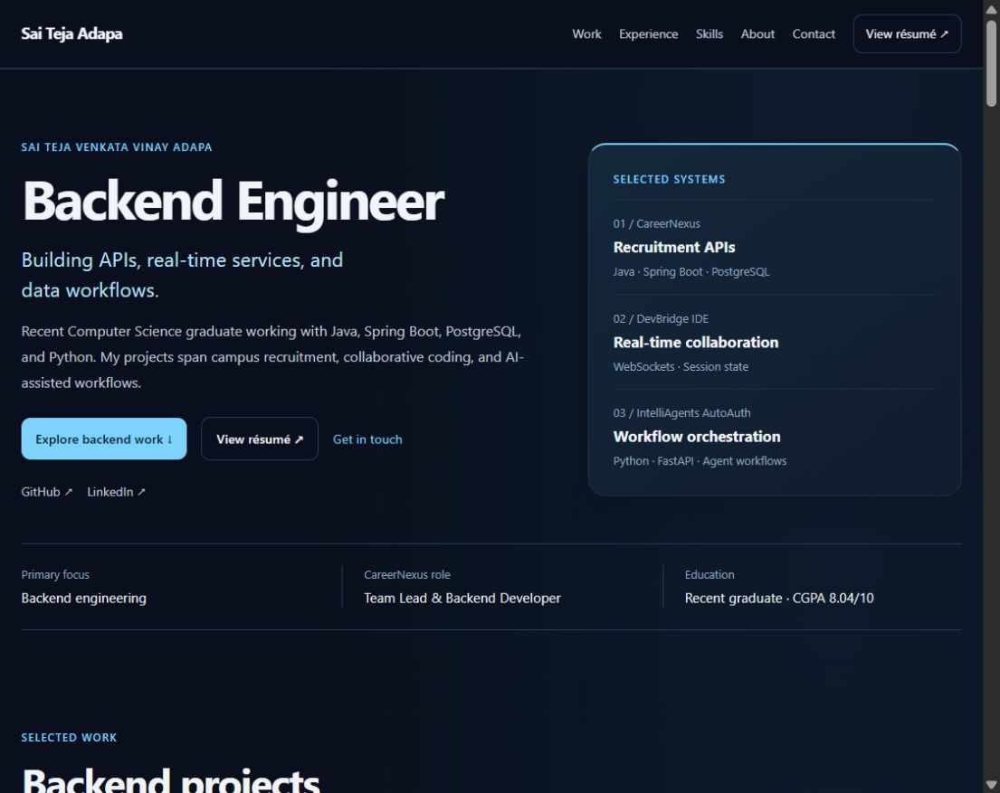
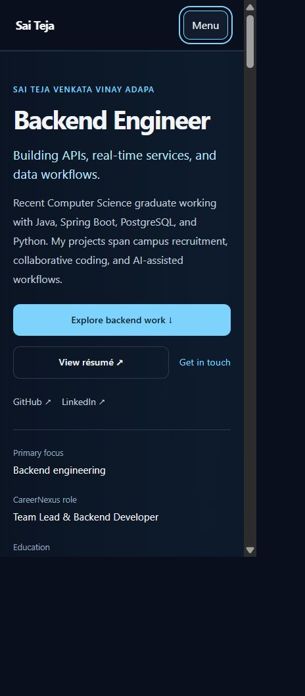
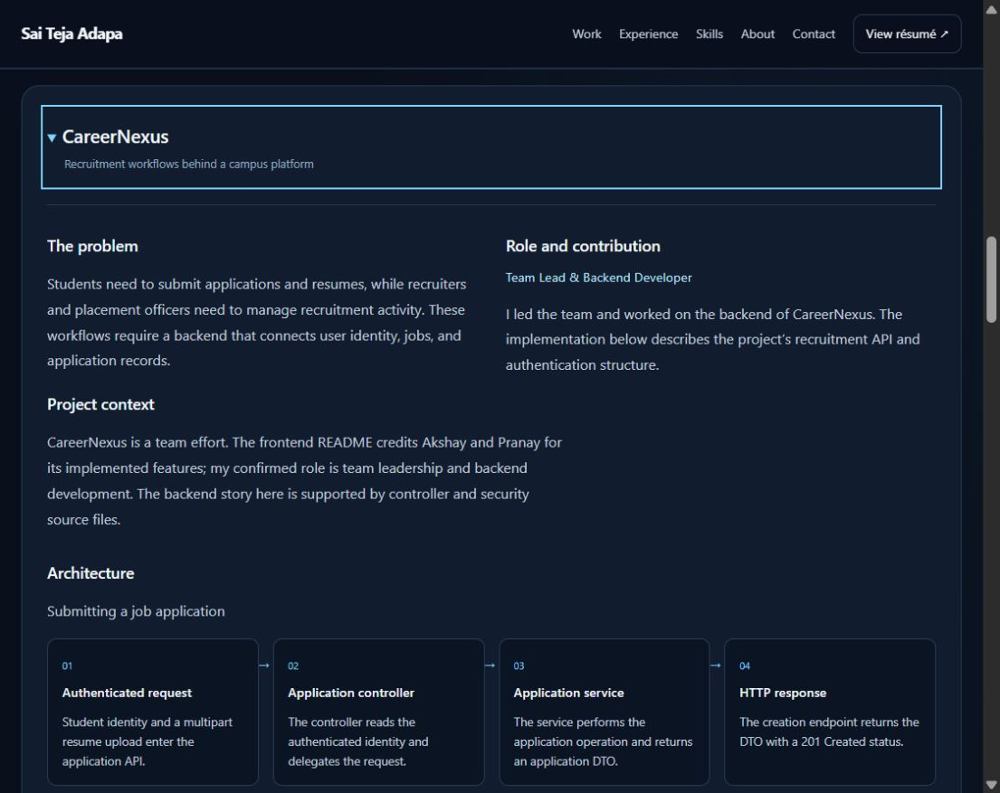

# Phase 3 portfolio visual design system

The shared portfolio now uses a navy foundation, high-contrast neutral text,
cyan accents, and consistent cards and controls. Typography and spacing establish
the hierarchy, while solid reading surfaces keep project evidence easy to scan.

## Design tokens

The source of shared values is `src/styles/tokens.css`.

| Token family | Purpose |
| --- | --- |
| Background, surface, and inset | Page, cards, diagrams, and form fields |
| Text, copy, and muted | Heading, paragraph, and secondary information hierarchy |
| Accent and secondary | Primary actions, links, focus, and limited violet tradeoff accents |
| Border and subtle border | Control boundaries and section separation |
| Spacing | Quarter-rem base steps and fluid section padding |
| Typography | System body font, code font, fluid section headings, reading width |
| Radius and shadows | Consistent control and card treatment |
| Feedback duration and easing | Brief control feedback, disabled for reduced motion |
| Status colors | Contact success and error feedback |

## Component treatments

- Buttons and resume controls share sizing, radii, borders, and hover feedback.
- Primary actions use cyan with dark text; secondary actions use outlined surfaces.
- Section headings, project headings, eyebrow text, and body copy have distinct roles.
- Project previews pair summary and backend focus with a clear divider.
- Case-study flows use inset panels; decision cards use a limited violet accent.
- Credentials use the same border and focus language as other links.
- Contact fields have visible labels, autocomplete, required states, and matching inset surfaces.
- The footer provides a consistent boundary and a back-to-top action.

These treatments are reusable CSS primitives across the existing React
components. Broader component/API restructuring belongs to Phase 4.

## Responsive composition

Desktop uses paired hero, project, background, and contact columns. Tablet
capability cards stack and architecture steps use two columns. Mobile uses one
column, vertical architecture flows, wrapping action rows, and a menu disclosure.
The same information is available across screen sizes.

Reduced-motion preferences disable CSS transitions and animations. The contact
form no longer depends on entrance animation to become visible. This phase uses
static visual depth; the interactive 3D scene remains a later-phase feature.

## Validation

- Changed JSX components pass ESLint and Git whitespace checks pass.
- Inspected desktop hero, projects, experience, case study, and contact treatments.
- Actual CSS viewport widths of 320, 390, 960, and 1124 pixels showed no horizontal overflow.
- The mobile menu returns keyboard focus on Escape with a visible outline.
- Primary and secondary controls measured at least 44 pixels tall.
- Name, email, and message fields have associated labels and remain required.
- Palette contrast ratios: body text/background 11.77:1; muted text/surface 6.95:1; primary button text/background 9.97:1; accent/surface 10.25:1. These palette checks do not establish complete accessibility conformance.
- Production build verification remains pending under the previously declined escalation.

## Previews

