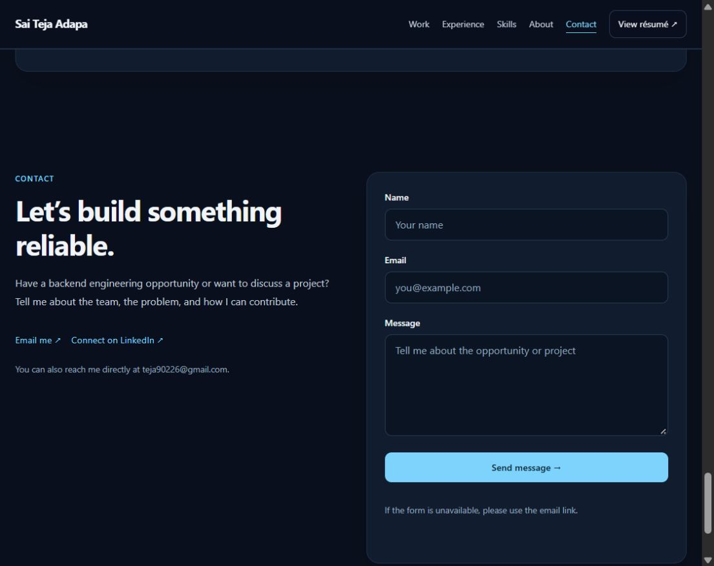

# Phases 4 and 5 architecture and complete reading experience

The portfolio is organized by feature with separate content, presentation,
motion, and contact-service responsibilities. The shared reading experience
retains project summaries, expandable case studies, experience, skills,
background, and contact.

## Code organization

- `src/app`: application shell and portfolio section composition.
- `src/components/layout`: navigation and footer.
- `src/features`: hero, projects, experience, skills, about, and contact components.
- `src/content`: project, case-study, profile, capability, and credential records.
- `src/services`: contact validation and lazy Firebase submission integration.
- `src/motion`: a persistent motion preference control; the app also sets MotionConfig to respect the system preference.
- `src/styles`: design tokens, layout rules, and component treatments.
- `tests`: contact validation and service error-message behavior.

The old timed introduction, particle background, circle decorations, unused
education timeline, and their styles were retired. The active about section
retains the confirmed education facts. AOS and particle dependencies were removed;
Motion is retained for the shared configuration and future visual enhancements.

## Static content and hydration

`npm run build` now runs the Vite client build and then `scripts/prerender.mjs`.
The renderer uses Vite SSR loading and React rendering to fill the root HTML with
the shared portfolio, including all case-study text. It maps imported asset URLs
to the client build manifest. The browser hydrates populated HTML and mounts
normally during development.

Case-study expansion begins after hydration, keeping initial server and client
markup consistent. Fragment links continue to work under the GitHub Pages base
path. Native details remain usable without JavaScript in the production HTML;
the email fallback is available independently of form submission.

Production build and hydration validation remain pending because the earlier
request to run the build outside the sandbox was declined. The prerender path
is implemented but must pass a production build before deployment.

## Contact behavior

Validation trims input, rejects empty/whitespace-only values, validates email,
and bounds name, email, and message length. Errors are associated with fields,
announced through persistent status text, and focus moves to the first invalid
field. Editing clears the corresponding error. Form contents remain intact on
service failure. Submission guards prevent simultaneous attempts, controls show
the pending state, and success is reported only after Firestore acknowledges
the save.

Firebase initializes lazily at submission time. The service uses a server
timestamp. Offline submissions provide a reconnect/email fallback. The owner's
public GitHub email is included as a direct contact option. Contact data is saved
to Firestore; an email notification or monitored inbox integration has not been
verified.

## Firestore access review

`firestore.rules` supplies a proposed contacts-only policy with bounded payloads,
an exact field set, server-time validation, and denied client reads, updates, and
deletes. It has not been deployed, and the currently deployed project's policy
has not been inspected. Merge and emulator-test these rules against the existing
project before deploying. Anonymous create access does not itself prevent spam;
App Check enforcement or a rate-limited endpoint requires separate configuration.

This distinction follows Firebase's [security-rule conditions](https://firebase.google.com/docs/firestore/security/rules-conditions)
and [App Check setup](https://firebase.google.com/docs/app-check/web/recaptcha-enterprise-provider).
Do not treat a local rules file or environment variable as proof of deployed access protections.

## Accessibility and motion

Main and section landmarks, a single primary heading, visible focus, native
details, associated form labels, required state, and linked errors support the
reading flow. Mobile navigation supports Escape and transfers focus to the
chosen section. The motion control persists its preference when storage is
available and respects a system reduced-motion preference. Native email and
resume links provide direct access.

## Verification

- Full repository ESLint passes.
- Five validation and failure-message tests pass.
- Browser invalid-submission checks confirmed field errors, first-field focus, retained text, and persistent feedback without sending data.
- The motion control sets reduced motion and disables smooth scrolling.
- Development browser rendering succeeds after the feature reorganization.
- Existing project fragments still open their studies after refresh; mobile navigation focuses the selected section at a 320-pixel CSS viewport.
- Cloud submission, notification delivery, deployed security rules, production prerendering, and hydration are still unverified.

