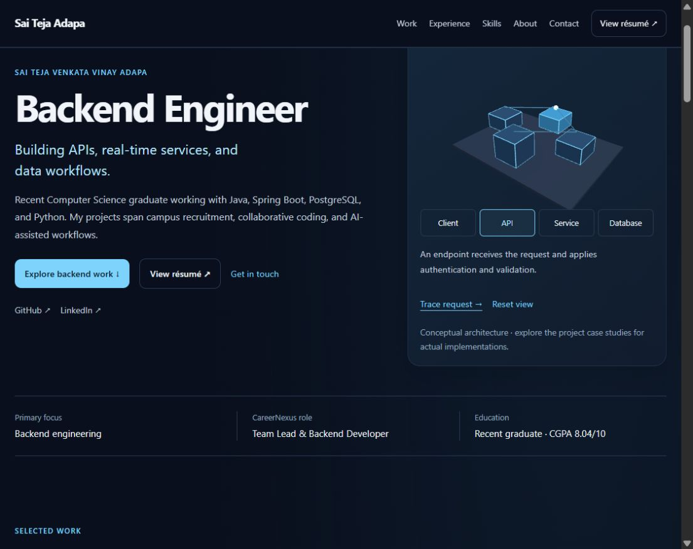

# Portfolio release status

The remaining implementation adds an interactive backend request-flow scene,
release artifact validation, publishing workflows, and metadata. The shared
portfolio remains usable through text, native controls, and a static diagram.

## Phase 6 3D implementation

- Three.js loads in a separate dynamic module after the hero mounts.
- Desktop uses a small lit scene with four backend layers, a connection path, a request packet, and pointer-driven camera composition.
- Native layer buttons expose the same explanation independently of the canvas.
- Request tracing runs for about two seconds after an explicit action, then stops.
- Rendering is event-driven while idle, stops offscreen or in a hidden tab, and respects reduced-motion preferences.
- Pixel ratio is capped at 1.5; the scene uses basic geometry and no large model downloads or shadow maps.
- Mobile and data-saving connections start with a static composition and an optional 3D action.
- Import/renderer errors and context loss retain the static content. Render resources are disposed on unmount.

The diagram represents conceptual architecture. Project case studies describe
actual implementation boundaries. Scene implementation follows the
[Three.js renderer documentation](https://threejs.org/docs/#WebGLRenderer).

## Phase 7 validation

Verified in this local session:

- Full repository ESLint passes and all five contact-validation tests pass.
- Desktop creates one WebGL canvas and the scene becomes ready.
- Layer selection updates both pressed state and explanatory text.
- Request tracing works with reduced motion enabled.
- At a 320-pixel CSS viewport, the static flow loads without a WebGL canvas and has no horizontal overflow; its layer controls still work.
- The local Vite server was restarted after compatible dependency updates and is running on port 5173.
- Compatible fixes and a patched gRPC override were applied. The final online npm install reported zero known vulnerabilities. An offline audit alone was not used as evidence.

`npm run verify:release` checks prerendered content, unique IDs, anchor targets,
local asset existence, source links, and compressed JavaScript budgets. Initial
JavaScript and each individual chunk have a 250 KiB gzip cap. The check requires
a fresh successful production build; it has not been run against a new bundle.

Core Web Vitals targets remain LCP at most 2.5 seconds, INP at most 200 milliseconds,
and CLS at most 0.1 at the 75th percentile. These are targets, not achieved scores.
No real-user or production Lighthouse result has been collected. See
[Google's Web Vitals guidance](https://web.dev/articles/vitals).

## Phase 8 release setup

- Custom favicon, PNG social preview, canonical URL, description, social metadata, robots file, and sitemap are included.
- Pull requests and manual validation run lint, tests, build, release verification, and the high-severity production dependency audit.
- A manually dispatched publishing workflow builds and checks the artifact before GitHub Pages deployment.
- The previous gh-pages package and scripts were removed in favor of the GitHub Actions publishing path.
- Build and deployment jobs have separate permissions. The Pages environment provides the deployment boundary.

Workflow setup follows [GitHub's custom Pages workflow guidance](https://docs.github.com/en/pages/getting-started-with-github-pages/using-custom-workflows-with-github-pages).
No publishing workflow has been dispatched and no changes have been pushed.

## Outstanding release gates

1. Run `npm run build` and `npm run verify:release`. The sandbox blocked configuration access, and permission to run the build outside it was declined during this session.
2. Inspect the built site through `npm run preview`, including hydration, case-study links, assets, and disabled-JavaScript behavior.
3. Measure production performance and conduct broader accessibility checks; local smoke checks do not establish WCAG conformance or passing field metrics.
4. Verify deployed Firestore rules, submission delivery, and a monitored recipient. Local rules remain a proposed policy, not an applied cloud change.
5. Configure GitHub Pages to use Actions and confirm the intended release branch before dispatching Publish portfolio.
6. Confirm current role dates, resume currency, and individual IntelliAgents ownership before strengthening those claims.

## Maintenance

Before each release, run lint, tests, build, release checks, and an online audit.
Review resume access, project/demo links, employment dates, and contact delivery
when their source changes. Keep benchmark claims tied to reproducible measurements.
Review Core Web Vitals after release when sufficient field data is available.

